  

 

[Qué es](#qué-es) · [Módulos](#módulos) · [Arquitectura](#arquitectura) · [Instalación](#instalación) · [Estructura](#estructura)

## Qué es

Aplicación web para administrar un taller de reparación y venta de repuestos: lleva las ventas, las órdenes de reparación con sus máquinas y técnicos, el inventario con su historial de movimientos y los reportes del negocio. Fue desarrollada para un negocio real, Electroneumática Aldana, y está construida con Laravel siguiendo una arquitectura por servicios.

## Módulos

| Módulo | Qué permite |
| :-- | :-- |
| **Dashboard** | Resumen del estado del negocio en una sola pantalla |
| **Ventas** | Registro de ventas con su detalle de productos |
| **Reparaciones** | Órdenes de reparación, máquinas y técnicos asignados |
| **Inventario** | Productos, movimientos de entrada y salida, y ajustes |
| **Técnicos** | Gestión del personal técnico y su trabajo |
| **Reportes** | Ventas, reparaciones, inventario, técnicos y financiero, más un resumen general, con exportación a Excel |

## Arquitectura

Los controladores reciben la petición, las clases Request validan los datos y la lógica de negocio vive en servicios separados por área. Los modelos Eloquent hablan con la base de datos.

~~~mermaid
flowchart LR
  V["Vistas Blade CSS y JS con Vite"] --> C["Controladores"]
  C --> Q["Requests validación"]
  C --> S["Servicios Dashboard, Inventario, Reportes, Técnicos, Ventas"]
  S --> M["Modelos Eloquent"]
  M --> D[("MySQL o MariaDB")]
~~~

### Modelo de datos simplificado

~~~mermaid
erDiagram
  CLIENTES ||--o{ ORDENES_REPARACION : solicita
  ORDENES_REPARACION }o--|| MAQUINAS : sobre
  ORDENES_REPARACION }o--|| TECNICOS : atiende
  PRODUCTOS ||--o{ MOVIMIENTOS : registra
  VENTAS ||--|{ DETALLE_VENTA : contiene
  PRODUCTOS ||--o{ DETALLE_VENTA : se_vende_en
~~~

## Tecnologías

  

 

| Capa | Tecnología |
| :-- | :-- |
| Backend | PHP 8.2 o superior · Laravel 12 · PhpSpreadsheet para exportar a Excel |
| Frontend | Blade · CSS · JavaScript · Vite |
| Base de datos | MySQL o MariaDB |
| Control de versiones | Git |

## Instalación

Requisitos: PHP 8.2 o superior, Composer, Node.js y MySQL o MariaDB.

~~~bash
git clone https://github.com/JuanCrespoAldana/Sistema-Inventario-Taller.git
cd Sistema-Inventario-Taller
composer install
cp .env.example .env
~~~

Configure la base de datos en el archivo .env y luego prepare la aplicación:

~~~bash
# .env: DB_HOST=127.0.0.1  DB_PORT=3306  DB_DATABASE=sistema_taller  DB_USERNAME=root  DB_PASSWORD=
php artisan key:generate
php artisan migrate
php artisan db:seed    # opcional: datos de ejemplo
npm install
~~~

Para ejecutarla en desarrollo use dos terminales:

~~~bash
php artisan serve      # http://127.0.0.1:8000
npm run dev
~~~

## Estructura

~~~text
app/
├── Http/
│   ├── Controllers/   Controladores de cada módulo
│   └── Requests/      Validación de formularios
├── Models/            Modelos Eloquent
└── Services/          Lógica de negocio
    ├── Dashboard/
    ├── Inventario/
    ├── Reportes/
    ├── Tecnicos/
    └── Ventas/
database/
├── migrations/        Esquema de la base de datos
├── factories/
└── seeders/           Datos de ejemplo
~~~

## Pruebas

~~~bash
php artisan test
~~~

## Autor

Juan José Crespo Aldana, estudiante de Ingeniería de Sistemas. [LinkedIn](https://www.linkedin.com/in/juan-jos%C3%A9-crespo-aldana-6b6456270/) · [GitHub](https://github.com/JuanCrespoAldana)
